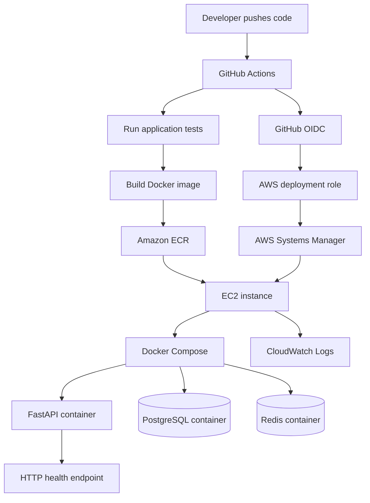

# ScreenHive — AWS DevOps Deployment

Infrastructure and delivery automation for the [ScreenHive FastAPI application](https://github.com/Ritacloud23/Cinema_Booking_API).

> Status: infrastructure code and pipeline scaffold are committed. AWS resources have not yet been provisioned, and no live deployment is claimed.

## Architecture

- Application: existing ScreenHive API; source remains in its original repository.
- Compute: one Amazon EC2 instance running Docker Compose.
- Registry: Amazon ECR with immutable SHA-based image tags and scan-on-push.
- Infrastructure: Terraform modules for networking, IAM, ECR, and EC2.
- CI/CD: GitHub Actions runs tests, builds and pushes the image, then deploys through AWS Systems Manager.
- Authentication: GitHub OIDC assumes an AWS role; no static AWS access keys are stored in GitHub.
- Runtime secrets: AWS Systems Manager Parameter Store SecureString.
- Logs: Docker awslogs driver sends API, PostgreSQL, and Redis logs to CloudWatch Logs.
- Region: us-east-1.

See [architecture source](docs/architecture.mmd), [Firebase setup](docs/firebase-setup.md), and [operations notes](docs/operations.md).

## Architecture diagram



## Why EC2?

EC2 with Docker Compose is a lower-complexity, cost-conscious starting point than ECS/Fargate plus a load balancer, while meeting the challenge's EC2/ECS/EKS requirement. The assessment environment is deliberately a single instance. It is not highly available.

## Repository structure

```text
.github/workflows/deploy.yml   GitHub Actions CI/CD
docs/                         Architecture, Firebase and operations notes
terraform/
  main.tf                     Environment composition
  modules/network/            VPC, subnet, routes and security group
  modules/registry/           ECR repository and lifecycle policy
  modules/iam/                EC2 instance role and GitHub OIDC role
  modules/compute/            EC2 instance and bootstrap
docker-compose.prod.yml       Production services
.env.example                  Runtime environment template (no real secrets)
```

## Application-specific deployment decisions

- The app entry point is app.main:app and the existing Dockerfile uses Python 3.14 with uv.
- PostgreSQL 16 and Redis 7 run as Compose services on the private Docker network; their ports are not published to the internet.
- Alembic migrations run before Uvicorn starts.
- Firestore remains enabled because ScreenHive uses it for the live showtime board and streaming endpoint. Firebase service-account JSON is retrieved from Parameter Store at deploy time and mounted read-only into the API container.
- The application starts an APScheduler job during FastAPI lifespan startup. Keep one API replica; multiple replicas could execute duplicate expiry jobs.
- The API listens on port 8000. This initial assessment setup does not include a custom domain or TLS termination.

## Prerequisites

1. An AWS account with permission to create VPC, EC2, ECR, IAM, SSM Parameter Store, and CloudWatch resources.
2. AWS CLI configured locally; verify the account with aws sts get-caller-identity.
3. Terraform 1.6 or later installed locally.
4. GitHub Actions enabled for this repository.
5. A Firebase project with Firestore enabled and a service-account JSON file. Do not upload the JSON to GitHub or this chat.

## Deploy infrastructure

From the repository root:

```bash
cd terraform
cp terraform.tfvars.example terraform.tfvars
terraform init
terraform fmt -recursive
terraform validate
terraform plan
terraform apply
```

Review the plan and AWS pricing before approving apply. The default EC2 size is t3.small with a 20 GiB encrypted gp3 root volume. Charges may include EC2 compute, EBS, a public IPv4 address, ECR image storage, CloudWatch logs, and data transfer. Check current prices and your account's Free Tier/credits; do not assume this deployment is free.

Terraform state is local in this assessment scaffold and must not be committed. A remote S3 backend with locking is a recommended improvement before team or production use.

## Configure runtime secrets

After Terraform completes, create these two AWS Systems Manager Parameter Store parameters in us-east-1, both as SecureString:

1. /screenhive/dev/runtime-env — multiline environment values: POSTGRES_USER, POSTGRES_PASSWORD, POSTGRES_DB, JWT_SECRET, PAYSTACK_SECRET (if payments are enabled), and FIREBASE_PROJECT_ID, AWS_REGION, and CLOUDWATCH_LOG_GROUP.
2. /screenhive/dev/firebase-service-account — the complete Firebase service-account JSON content.

Use unique strong database and JWT secrets. The Firebase JSON must fit the 4 KB Standard Parameter Store SecureString limit. See [docs/firebase-setup.md](docs/firebase-setup.md) for exact instructions. Never commit these values or place them in Terraform variables/state.

## Configure GitHub repository variables

Open Settings → Secrets and variables → Actions → Variables and add:

| Variable | Value |
|---|---|
| AWS_ROLE_ARN | Value of terraform output github_actions_role_arn |
| EC2_INSTANCE_ID | Value of terraform output instance_id |
| ECR_REPOSITORY_NAME | screenhive-dev |

No AWS access key or secret key is required. The IAM trust policy permits the main branch of this repository to assume the deployment role using GitHub OIDC.

Wait until the EC2 instance is online in Systems Manager Managed nodes before starting the workflow.

## Run CI/CD

The workflow is .github/workflows/deploy.yml. It runs on pushes to main and can also be started manually from Actions → ScreenHive AWS Deployment → Run workflow (select main).

The workflow checks out this deployment repository and the public application repository, installs dependencies, runs the application's tests, builds the Docker image, pushes an immutable SHA-tagged image to ECR, and deploys through SSM Run Command.

Changes pushed only to Cinema_Booking_API do not automatically trigger this repository's workflow. After changing the application source, run the deployment workflow manually, or push a deployment-repository change to main.

## Verify

- API root: http://YOUR_EC2_PUBLIC_IP:8000/
- Swagger UI: http://YOUR_EC2_PUBLIC_IP:8000/docs
- CloudWatch log group: /screenhive/dev
- Check API logs for Firebase initialization and Firestore permission errors.
- Test the live showtime stream with a valid showtime ID; the root endpoint alone does not validate Firestore.

## Security and limitations

- Inbound traffic is currently open to TCP/8000 from the internet so the assessor can reach the API. No SSH, PostgreSQL, or Redis inbound rules are created.
- The API is plain HTTP on port 8000. Add HTTPS and a domain before handling real user traffic.
- Single EC2 instance: no multi-AZ failover, autoscaling, or load balancing.
- PostgreSQL and Redis data use local Docker volumes on the EC2 root disk. Configure backups before relying on the data.
- Runtime parameters are SecureString; the instance role can read only the two ScreenHive parameters. KMS decrypt permission is required.
- The Docker image is built from the current main branch of the application repository. Pin the source commit for stricter release reproducibility.
- The API's APScheduler is a single-instance design constraint.
- Review SQLAlchemy SQL echo settings and ensure logs do not disclose sensitive data.

## Cleanup

To avoid ongoing charges, after the assessment run terraform destroy from the terraform directory and confirm the plan. This removes the EC2 instance, ECR repository, network, IAM resources, and CloudWatch log group managed by this configuration. ECR repository deletion removes stored images. Delete the two manually created Parameter Store SecureString parameters separately if no longer needed. Preserve any data you need before destroying the EC2 instance.

## Assessment evidence

- [ ] Terraform plan reviewed and apply completed.
- [ ] GitHub Actions test job passes.
- [ ] Docker image pushed to ECR.
- [ ] SSM deployment completes successfully.
- [ ] API root and Swagger endpoints verified.
- [ ] Firestore-backed live showtime endpoint verified.
- [ ] CloudWatch logs visible.
- [ ] Screenshots and verified endpoint added here.